# RouteWise — Smart Delivery and Route Optimization System

A console-based C++ application for a courier company. RouteWise manages customers and parcels, dispatches normal and urgent deliveries, keeps a delivery history with undo, indexes parcels in search trees, and plans routes and networks over a city road map.

**Every data structure is written from scratch.** No STL containers (`vector`, `list`, `stack`, `queue`, `map`, `set`, `priority\_queue`, ...) are used anywhere. The only libraries included are `iostream`, `fstream`, `string` and `iomanip`.

> \*\*Course:\*\* CL2001 – Data Structures Lab, National University of Computer and Emerging Sciences
> \*\*Platform:\*\* Console application, C++11 or newer

## Team

|Name: HAFIZA AYESHA SARFRAZ|Roll No: 25F-6566|
|-|-|
|*Teammate Name: UMAMA AMIR*|*Teammate Roll NO: 25F-3061*|

\---

## Table of Contents

1. [Features](#features)
2. [Data structures and where they are used](#data-structures-and-where-they-are-used)
3. [Project structure](#project-structure)
4. [Build and run](#build-and-run)
5. [Data file format](#data-file-format)
6. [Demonstration scenario](#demonstration-scenario)
7. [Screenshots](#screenshots)
8. [Algorithms and time complexity](#algorithms-and-time-complexity)
9. [Design decisions](#design-decisions)
10. [Limitations and possible improvements](#limitations-and-possible-improvements)

\---

## Features

One integrated menu exposes every feature:

```
=========================================
        ROUTEWISE DELIVERY SYSTEM
=========================================
 1. Register Customer
 2. Register Parcel
 3. Search Parcel
 4. Add Normal Delivery Request
 5. Add Urgent Delivery Request
 6. Process Next Delivery
 7. Mark Parcel as Delivered
 8. Undo Last Operation
 9. Display Pending Deliveries
10. Display Parcel Records
11. Display City Network
12. BFS Network Traversal
13. DFS Network Traversal
14. Find Shortest Delivery Route
15. Generate Minimum Delivery Network
16. Compare BST and AVL Performance
17. Display System Statistics
18. Exit
=========================================
```

|#|Option|What it does|Main structure|
|-|-|-|-|
|1|Register Customer|Stores ID (automatic), name, phone, address|Hash table|
|2|Register Parcel|Validates customer and locations, then stores the parcel (tracking ID is automatic)|Hash table, BST, AVL|
|3|Search Parcel|Finds a parcel by tracking ID and shows how many slots were checked|Hash table (probing)|
|4|Add Normal Delivery Request|Parcel joins the back of the normal line|Queue|
|5|Add Urgent Delivery Request|Parcel joins the urgent priority list|Heap|
|6|Process Next Delivery|Dispatches the next parcel (urgent first) and shows its shortest route|Heap, Queue, Dijkstra|
|7|Mark Parcel as Delivered|Completes a parcel that is being processed|Linked list (history)|
|8|Undo Last Operation|Reverses the most recent status change|Stack|
|9|Display Pending Deliveries|Urgent list in dispatch order, normal queue, next parcel, delivery history|Heap, Queue, Linked list|
|10|Display Parcel Records|All parcels sorted by tracking ID|AVL (inorder traversal)|
|11|Display City Network|Shows the map as adjacency list and adjacency matrix; add locations and roads|Graph|
|12|BFS Network Traversal|Traversal order from a chosen start, plus a reachability check|Queue|
|13|DFS Network Traversal|Traversal order from a chosen start, plus a reachability check|Stack|
|14|Find Shortest Delivery Route|Best route and total distance between two locations|Dijkstra + Heap|
|15|Generate Minimum Delivery Network|Cheapest set of roads that connects all locations|Prim + Heap|
|16|Compare BST and AVL Performance|Height and search steps of both trees, with a large-data demo|BST, AVL|
|17|Display System Statistics|Counts by status, queue sizes, network size, hash table load, tree heights|all|
|18|Exit|Frees all memory and quits|—|

Other behaviour:

* **Input is validated everywhere.** Wrong numbers, unknown names, empty answers and out-of-range values are rejected with a message. Pressing Enter cancels most questions.
* **Nothing is hard-coded.** The city, customers and parcels are loaded from a text file at start-up, and everything can also be added from the menu.
* **Location names are not case-sensitive** (`airport` finds `Airport`).

\---

## Data structures and where they are used

All structures are templates (generic) and are implemented in their own header files.

|Structure|File|Used for|
|-|-|-|
|Singly linked list (head and tail pointers)|`LinkedList.h`|Delivery history (newest first); road lists of the graph; base of the stack and queue|
|Stack|`Stack.h`|Undo records; DFS traversal|
|Queue|`Queue.h`|Normal delivery requests (first come, first served); BFS traversal|
|Binary heap (array-based, grows automatically)|`Heap.h`|Urgent requests (highest priority first, then earliest arrival); Dijkstra; Prim|
|Hash table, linear probing|`HashTable.h`|Parcel lookup by tracking ID; customer lookup by customer ID|
|Binary Search Tree|`BST.h`|Ordered parcel index (used for comparison with AVL)|
|AVL tree (self-balancing, rotations)|`AVL.h`|Balanced parcel index; sorted display of parcels|
|Graph (adjacency list **and** adjacency matrix)|`Graph.h`|City road network (weighted, undirected)|
|BFS / DFS|`Traversal.h`|Network exploration and reachability|
|Dijkstra's shortest path|`Dijkstra.h`|Best delivery route|
|Prim's minimum spanning tree|`MST.h`|Minimum-cost delivery network|

**How they work together.** A parcel is created once with `new` and is then referenced from several structures: the hash table owns it, and the BST and AVL tree only point to it. Delivery requests refer to a parcel by its tracking ID. When a delivery is dispatched, the heap or queue decides the order, the hash table finds the parcel, the linked list records the history, the stack records the undo information, and Dijkstra on the graph finds the route.

\---

## Project structure

```
RouteWise/
├── main.cpp               Menu loop (start here)
├── RouteWise.h            The whole system: owns every data structure and frees memory
├── Customer.h             Customer record
├── Parcel.h               Parcel record and status
├── UrgentRequest.h        Urgent request record and priority rule
├── UndoRecord.h           What the undo stack remembers
├── HistoryEntry.h         One line of delivery history
│
├── LinkedList.h           ┐
├── Stack.h                │
├── Queue.h                │  Data structures
├── Heap.h                 │  (written from scratch)
├── HashTable.h            │
├── BST.h                  │
├── AVL.h                  │
├── Graph.h                ┘
├── Traversal.h            BFS, DFS, reachability
├── Dijkstra.h             Shortest path
├── MST.h                  Minimum spanning tree
│
├── Input.h                Safe keyboard input helpers
├── FileLoader.h           Reads the data file
├── ParcelOps.h            Menu options 1, 2, 3, 10
├── DispatchOps.h          Menu options 4 to 9 (requests, dispatch, delivery, undo)
├── NetworkOps.h           Menu options 11 to 15
├── StatsOps.h             Menu options 16, 17
│
├── routewise\_data.txt     Sample dataset
└── docs/      Screenshots
```

\---

## Build and run

### Visual Studio (Windows)

1. Open the solution, or create a **Console App (C++)** project and add all the `.h` files and `main.cpp`.
2. Make sure `routewise\_data.txt` is in the **same folder as `main.cpp`** (the project folder).
3. Press **Ctrl + F5**.

### g++ (Linux, macOS, or MinGW on Windows)

```bash
g++ -std=c++11 -o routewise main.cpp
./routewise            # on Windows: routewise.exe
```

Run the program from the folder that contains `routewise\_data.txt`. If the file is not found, the program asks for another file name, or you can press Enter to start with an empty system.

\---

## Data file format

`routewise\_data.txt` is a plain text file with one record per line. Fields are separated by `|`. Lines starting with `#` are comments. Locations must come before the roads and parcels that use them.

|Line|Meaning|
|-|-|
|`L\|name`|A location|
|`R\|location A\|location B\|km`|A two-way road with a positive distance|
|`C\|name\|phone\|address`|A customer (IDs are given automatically: 1, 2, 3, ...)|
|`P\|customer ID\|source\|destination\|kg\|priority`|A parcel (tracking IDs are given automatically from 1001); priority is 1 (low) to 5 (high)|

Bad lines are skipped with a message that names the line number, so a broken file never crashes the program.

**Sample network** (8 locations, 10 two-way roads):

|Road|km|
|-|-:|
|Warehouse – City Center|5|
|Warehouse – Industrial Area|4|
|City Center – University|6|
|City Center – Hospital|3|
|City Center – Railway Station|4|
|University – Airport|7|
|Hospital – Residential Area|5|
|Railway Station – Airport|10|
|Industrial Area – Railway Station|6|
|Residential Area – Airport|8|

\---

## Demonstration scenario

This walks through every capability the project requires. Type the lines in order.

|Step|Type|What to look for|
|-|-|-|
|1|`4` then `1001`|Parcel 1001 joins the **normal queue**|
|2|`5` then `1005`, then `5` then `1002`|Both have priority 5, so they go to the **urgent heap**|
|3|`9`|1005 is listed before 1002 (same priority, earlier arrival); "Next to be dispatched: parcel 1005 (urgent)"|
|4|`6`|Dispatches 1005 and shows `Warehouse -> City Center -> Railway Station`, 9 km|
|5|`8`|**Undo**: parcel 1005 goes back to Pending and returns to the top of the urgent list|
|6|`3` then `1004`|**Hash table lookup** with the number of slots checked|
|7|`14`, `Warehouse`, `Airport`|**Shortest path**: `Warehouse -> City Center -> University -> Airport`, **18 km**|
|8|`12`, `Warehouse`, `Airport`|**BFS** order and reachability|
|9|`13`, `Warehouse`, `Airport`|**DFS** order and reachability|
|10|`15`|**Minimum spanning tree**: 7 of 10 roads, total **34 km**|
|11|`16`, then `1000`|**BST vs AVL**: height 1000 against 10 for 1000 sorted records|
|12|`17`|System statistics|

Example output of step 7:

```
Source: Warehouse
Destination: Airport
Recommended Route:
Warehouse -> City Center -> University -> Airport
Total Distance: 18 km
```

Example output of step 11 (first part, for the 8 sample parcels):

```
                          BST       AVL
Tree height               8         4
Best possible height      4         4
Average search steps      4.50      2.62
Worst search steps        8         4
Rotations done            -         4
```

\---

## Screenshots

> Add your own screenshots to `docs/` using these names.

| Feature | Screenshot |
|---|---|
| Main menu | 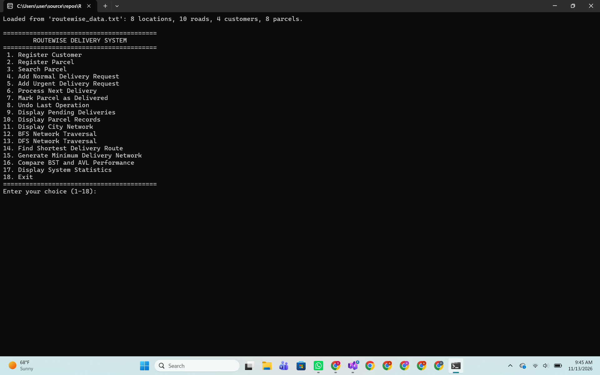 |
| Parcel registration | 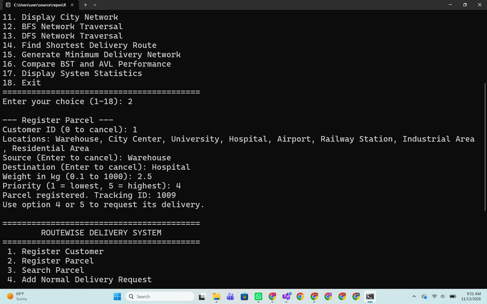 |
| Tracking lookup (hash table) | 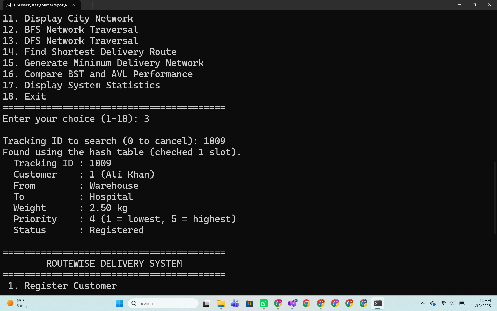 |
| Priority dispatching | 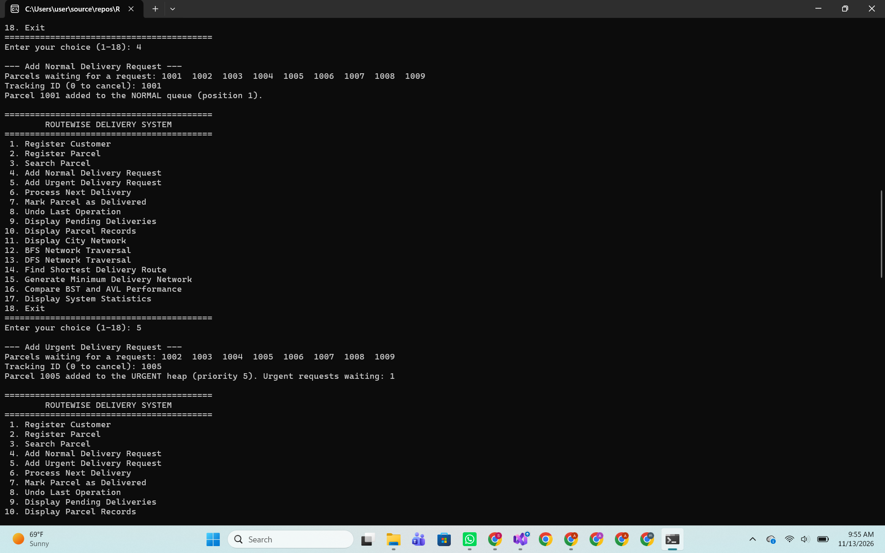 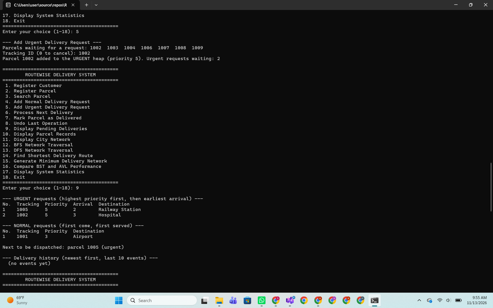 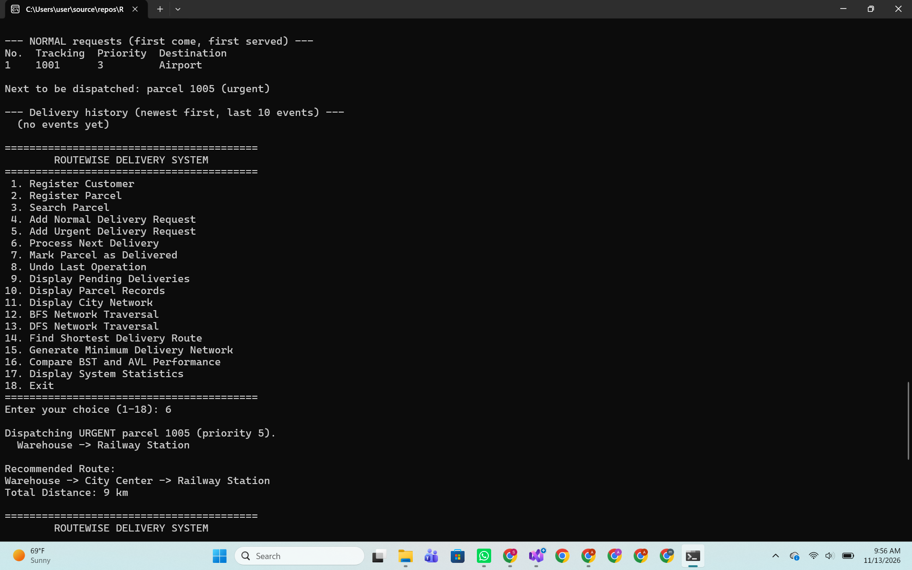 |
| Undo | 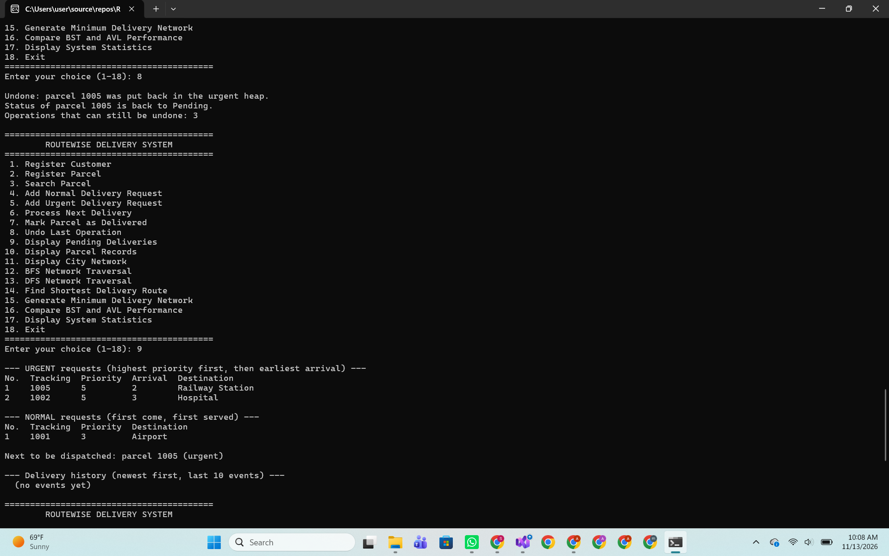 |
| Route optimization (shortest path) | 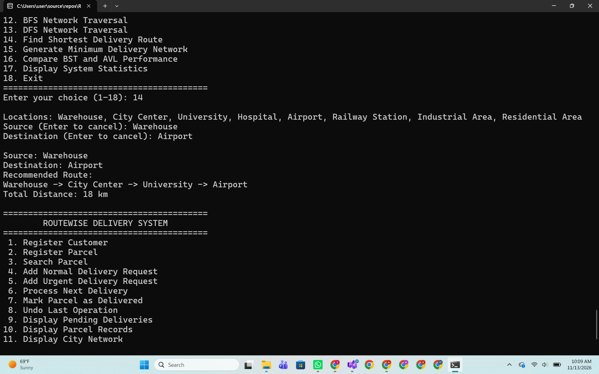 |
| BFS / DFS traversal | 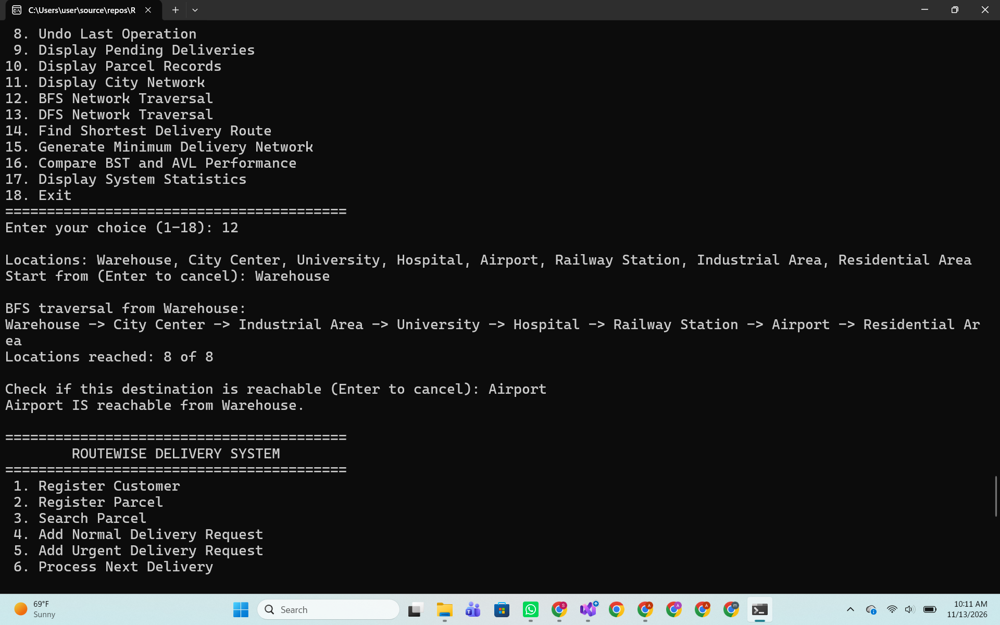  |
| Minimum spanning tree | 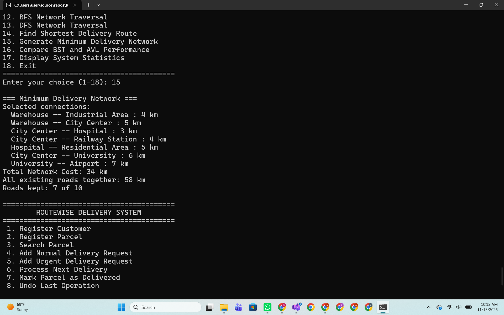 |
| BST vs AVL comparison | 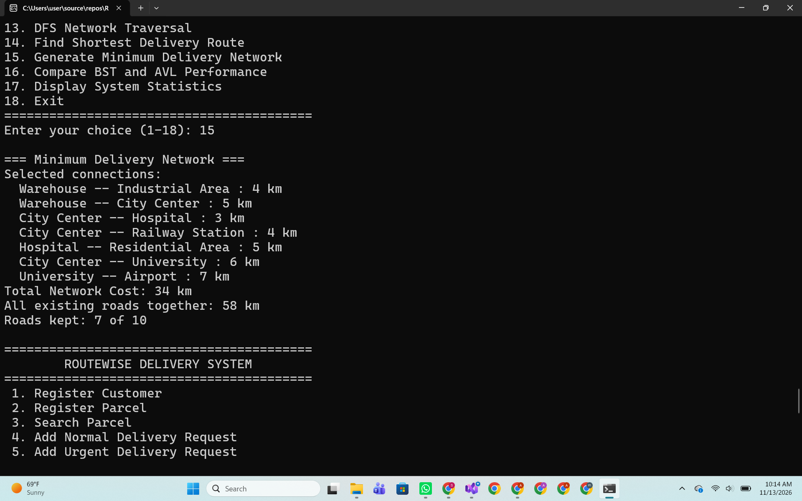 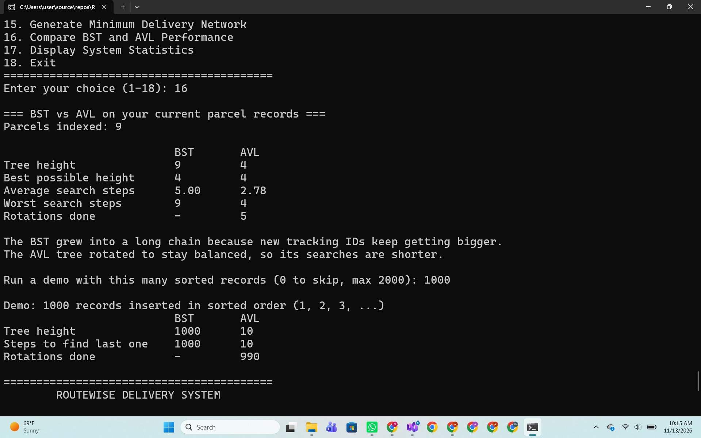 |
| Program exit | 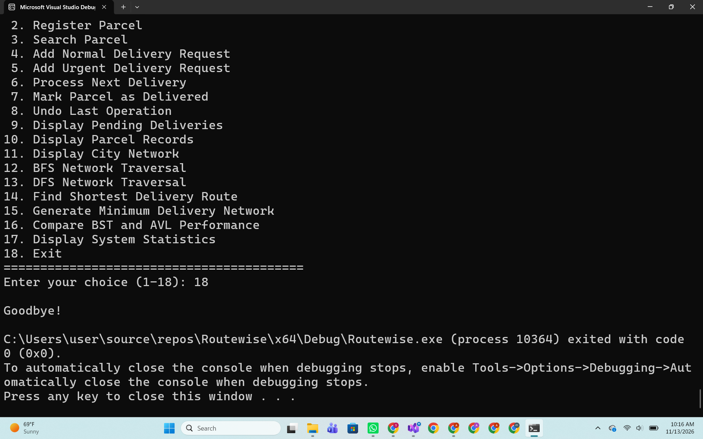 |

\---

## Algorithms and time complexity

Notation: **n** = number of parcels, **k** = number of waiting requests, **V** = locations, **E** = roads, **h** = height of a tree, **deg** = roads at one location.

### Data structure operations

|Structure|Operation|Time|
|-|-|-|
|Linked list|`pushFront`, `pushBack`, `popFront`|O(1)|
|Linked list|`removeValue`, `contains`|O(n)|
|Stack|`push`, `pop`, `peek`|O(1)|
|Queue|`enqueue`, `enqueueFront`, `dequeue`, `peek`|O(1)|
|Queue|`remove(value)`|O(n)|
|Binary heap|`insert`, `extract`|O(log n)|
|Binary heap|`peek`|O(1)|
|Hash table (linear probing)|`insert`, `search`, `remove`|O(1) average, O(n) worst case|
|Hash table|rehash (when more than half full)|O(n), amortised O(1) per insert|
|BST|`insert`, `search`|O(log n) average, **O(n) worst case** (sorted input makes a chain)|
|AVL tree|`insert`, `search`|**O(log n) always** (height ≤ 1.44 log₂ n)|
|BST / AVL|any traversal|O(n)|
|Graph|add location, add road|O(V)|
|Graph|road exists? (matrix)|O(1)|
|Graph|list the roads of a location (list)|O(deg)|

### Algorithms

|Algorithm|Structure used|Time|
|-|-|-|
|BFS|Queue + visited array|O(V + E)|
|DFS|Stack + visited array|O(V + E)|
|Reachability|BFS|O(V + E)|
|Dijkstra shortest path|Heap, adjacency list|O((V + E) log V)|
|Prim minimum spanning tree|Heap, adjacency list|O((V + E) log V)|

### Menu operations

|Operation|Time|
|-|-|
|Search parcel (option 3)|O(1) average|
|Register parcel (option 2)|O(1) hash + O(h) BST + O(log n) AVL, so O(n) in the worst case because of the plain BST|
|Add normal request (option 4)|O(1)|
|Add urgent request (option 5)|O(log k)|
|Process next delivery (option 6)|O(log k), plus Dijkstra for the route|
|Mark delivered (option 7)|O(1)|
|Undo (option 8)|O(1) for dispatch and delivery of a normal parcel; O(k) to cancel a normal request; O(k log k) to cancel an urgent request (the heap is rebuilt)|
|Display pending (option 9)|O(k log k)|
|Display parcel records (option 10)|O(n)|
|Compare BST and AVL (option 16)|O(n · h)|

### Why both a BST and an AVL tree?

Tracking IDs are issued in increasing order (1001, 1002, ...). Inserting sorted keys into a plain BST turns it into a **linked list**: its height equals the number of records, and a search may visit all of them. The AVL tree rotates to stay balanced, so its height stays about log₂ n:

|Sorted records|BST height|AVL height|
|-|-:|-:|
|7|7|3|
|100|100|7|
|1000|1000|10|
|2000|2000|11|

\---

## Design decisions

* **One owner for every record.** The two hash tables own the customers and parcels. The BST, AVL tree, queue and heap only hold pointers or tracking IDs. One destructor in `RouteWise` frees every record, and every structure frees its own nodes and arrays.
* **Urgent before normal.** "Process Next Delivery" always takes from the urgent heap first, and only uses the normal queue when no urgent request is waiting.
* **Priority rule.** Higher priority first. Equal priority is decided by arrival order, using an arrival number that is stored with each request.
* **Undo covers every status change.** Requesting a delivery, dispatching and delivering each push an undo record. Undoing a dispatch puts the parcel back exactly where it was: the **front** of the normal queue, or back into the heap with its original arrival number. The history list stays in step with the undo stack.
* **Route shown at dispatch.** Processing a delivery also runs Dijkstra between the parcel's source and destination.
* **Cut-off areas are handled.** If some locations have no road to the rest of the city, BFS and DFS show only what is reachable, Dijkstra reports "no route", and the minimum spanning tree reports one network per separate part.
* **No recursion on long chains.** The plain BST inserts, measures its height and deletes its nodes with loops instead of recursion, so a very long chain cannot overflow the stack. It was tested with 100,000 sorted parcels.
* **Generic structures.** The containers are templates, so one linked list serves history, road lists, the stack and the queue, and one heap serves urgent dispatch, Dijkstra and Prim.

\---

## Limitations and possible improvements

* Changes made while the program runs (new customers, parcels, locations, roads) are **not saved** when you exit. Only the data file is read, at start-up.
* Parcels, customers and locations cannot be deleted.
* Roads are two-way and distances are whole kilometres.
* Tracking IDs and customer IDs are given automatically, not typed by the user.
* Ideas for later: saving data to a file, dispatcher and administrator login roles, a graphical map, exporting completed deliveries, parcel deletion with AVL rebalancing.

